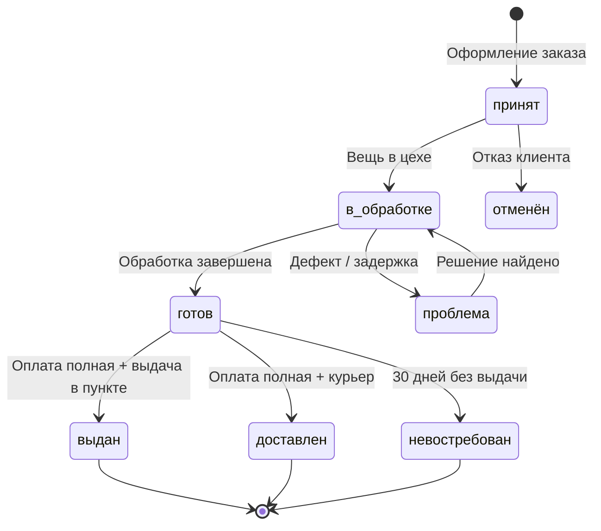

# Диаграмма статусов

## Ограничения

- `готов → выдан` блокируется, если `SUM(payments.amount) < order.amount`.
- Автопереход в `невостребован` выполняется ежедневным job'ом.
- Уведомления отправляются на переходы: `принят`, `готов`, `проблема`, `невостребован`.
