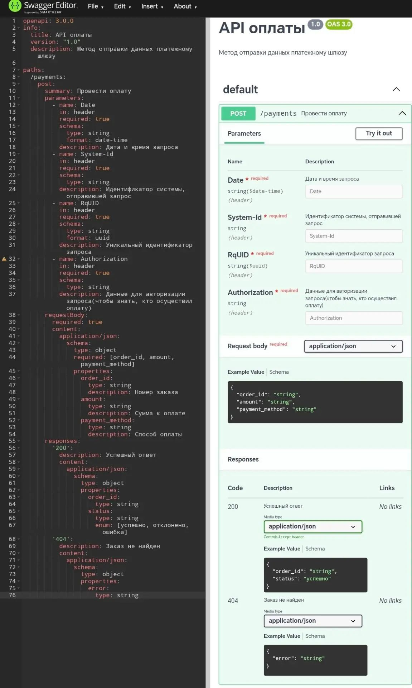

# Платёжный API

## Контекст

Клиент оплачивает заказ онлайн — без визита в пункт. Система вызывает
платёжный шлюз и получает статус транзакции через callback.

## Решение

- `POST /payments` — инициировать оплату.
- Идемпотентность через заголовок `RqUID` (UUID) — защита от двойных списаний.
- Авторизация через `Authorization`, идентификация системы — `System-Id`.
- Ответы: `200` (успешно / отклонено / ошибка), `404` (заказ не найден).

## Передаваемые данные

| Поле | Направление | Описание |
|------|-------------|----------|
| `order_id` | → шлюз | Номер заказа |
| `amount` | → шлюз | Сумма к оплате |
| `payment_method` | → шлюз | Способ оплаты |
| `status` | ← шлюз | `успешно` / `отклонено` / `ошибка` |

## Риски и ограничения

- Зависимость от доступности шлюза → retry с идемпотентным ключом.
- Защита ПДн — соответствие 152-ФЗ.
- Двойные списания → `RqUID` обязателен.

## Файлы

- [`openapi.yaml`](./openapi.yaml) — спецификация OpenAPI 3.0
  
## Визуализация в Swagger Editor

Спецификация успешно проходит валидацию и отображается в Swagger UI:
 
