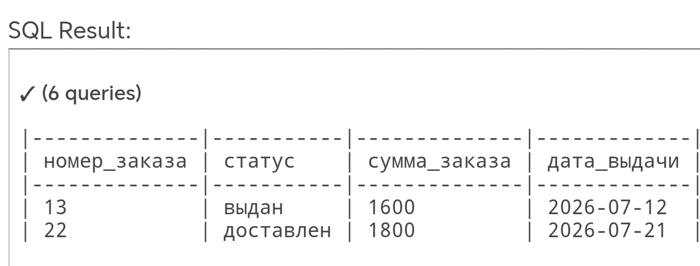
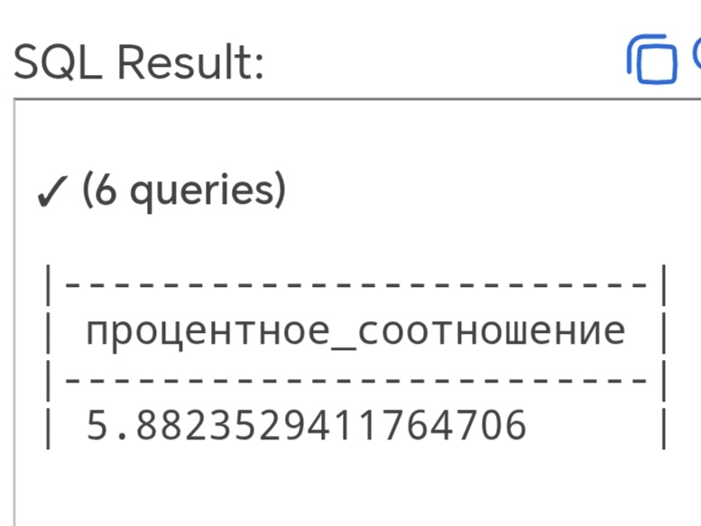
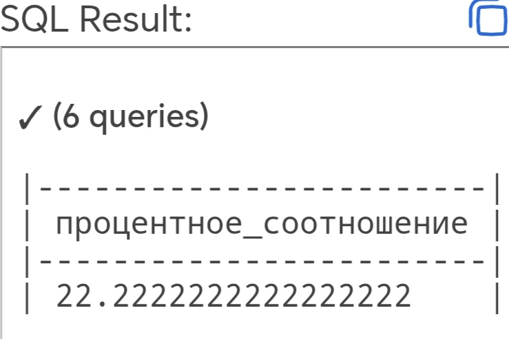
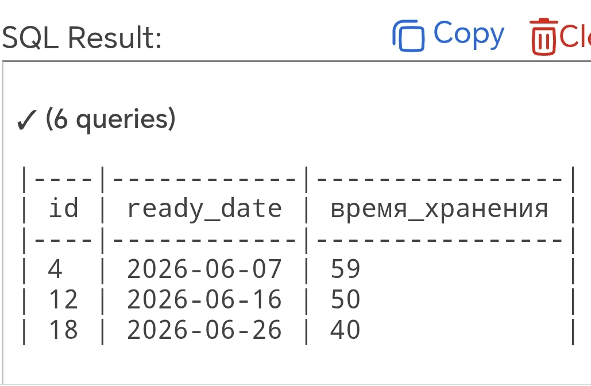

markdown
## SQL-проверки гипотез

Проверка требований и гипотез на данных после нескольких месяцев работы системы.

## Проверка 1. Выявление полностью или частично неоплаченных заказов

```sql
SELECT o.id AS order_id,
       o.amount AS стоимость_заказа,
       SUM(p.amount) AS сумма_платежей
FROM orders o
JOIN payments p ON p.order_id = o.id
WHERE o.status IN ('выдан', 'доставлен')
GROUP BY o.id, o.amount
HAVING SUM(p.amount) < o.amount;
```

**Требование:** заказ нельзя выдать без полной оплаты.

## Проверка 2. Гипотеза о проблемах в экспресс-тарифе

```sql
SELECT 100.0 * COUNT(*) / (
  SELECT COUNT(*) FROM orders WHERE tariff = 'обычный'
) AS процент_проблем
FROM orders
WHERE tariff = 'обычный' AND status = 'проблема';

SELECT 100.0 * COUNT(*) / (
  SELECT COUNT(*) FROM orders WHERE tariff = 'экспресс'
) AS процентное_соотношение
FROM orders
WHERE tariff = 'экспресс' AND status = 'проблема';
```
 

**Гипотеза подтвердилась:** процент проблем в экспресс-тарифах выше в **3,78 раза** (22,22% / 5,88%).

## Проверка 3. Выявим заказы с просроченным сроком выдачи

```sql
SELECT id, ready_date,
       DATE '2026-08-05' - ready_date AS время_хранения
FROM orders
WHERE pickup_date IS NULL
  AND ready_date IS NOT NULL
  AND DATE '2026-08-05' - ready_date >= 25;
```


**Требование:** соблюдать правило оферты о 30 днях хранения.

## Python-реализация

Выявление неоплаченных заказов переписано на pandas — аналог SQL-запроса
для ad-hoc анализа выгрузок.

- [`tariff_check.py`](./tariff_check.py) — расчёт доли проблем по тарифам
- [`test_tariff_check.py`](./test_tariff_check.py) — тесты (pytest)
- [`data/orders.csv`](./data/orders.csv) — тестовые данные

```bash
