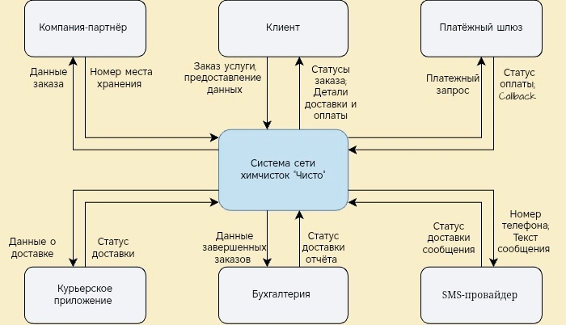

markdown
# Интеграции

## Карта внешних систем

Система учёта заказов взаимодействует со следующими внешними сервисами:

| Система / Участник | Назначение | Что передаем (туда) | Что получаем (обратно) |
| :--- | :--- | :--- | :--- |
| **Платёжный шлюз** | Онлайн-оплата заказов | Номер заказа, сумма, способ оплаты | Статус транзакции (успешно / отклонено / ошибка) |
| **SMS-провайдер** | Оповещение клиентов | Номер телефона, текст сообщения | Статус доставки SMS (доставлено / не доставлено) |
| **Курьерское приложение** | Управление доставкой | Номер заказа, адрес, временное окно | Результат визита (выдан / клиент недоступен) |
| **Бухгалтерия (1С)** | Формирование отчётности | Список завершенных заказов (номер, сумма, даты) | Подтверждение получения файла |
| **Компания-партнёр** | Хранение невостребованных вещей | Номер заказа, описание вещи, дата | Присвоенный номер места хранения |

## Контекстная схема системы

На схеме отображены границы системы и направления обмена данными с внешними сущностями:

---

---

## Риски интеграций и способы их снижения

При проектировании внешних взаимодействий были выявлены потенциальные риски. Для каждого предусмотрено техническое или организационное решение.

| Интеграция | Потенциальный риск | Ограничения / Решение |
| :--- | :--- | :--- |
| **1. Платёжный шлюз** | Двойное списание средств; зависание транзакции при сбое сети. | Использование идемпотентного ключа `RqUID` для каждого запроса. Настройка автоматических повторных запросов (retry) с проверкой статуса транзакции. |
| **2. SMS-провайдер** | Сообщение не доставлено; SMS пришло с задержкой (клиент не узнал статус вовремя). | Настройка резервного канала оповещения (например, email или push). Внедрение лимитов на отправку для защиты от спама и «задвоения» сообщений. |
| **3. Курьерское приложение** | Потеря связи в пути; недоступность серверов системы (курьер не видит заказ). | Возможность работы приложения в офлайн-режиме (кэширование данных на устройстве). Автоматическая синхронизация данных при восстановлении связи. |
| **4. Бухгалтерия (1С)** | Задержка выгрузки данных; передача избыточных или конфиденциальных данных. | Строгое соблюдение регламента форматов выгрузки (XML/JSON). Ограничение доступа к финансовым данным на уровне ролей. |
| **5. Компания-партнёр** | Ошибка идентификации вещи; утечка персональных данных клиента. | Передача только необходимого минимума данных (без ФИО и телефона клиента, только номер заказа и описание вещи). |
